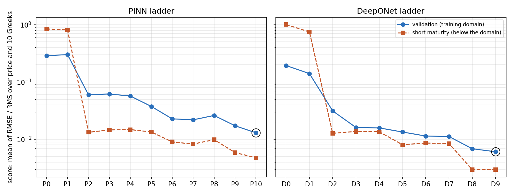
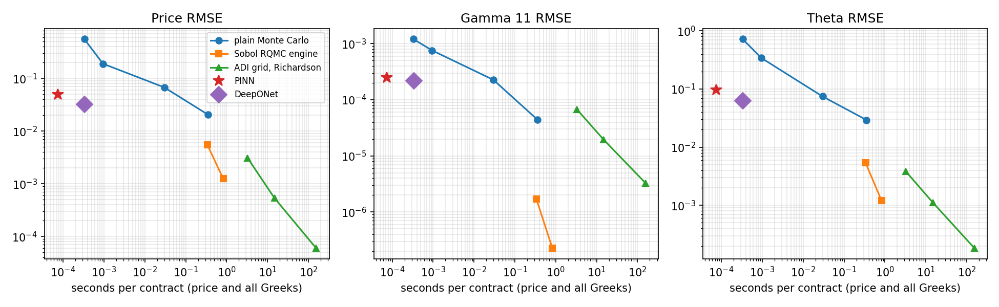
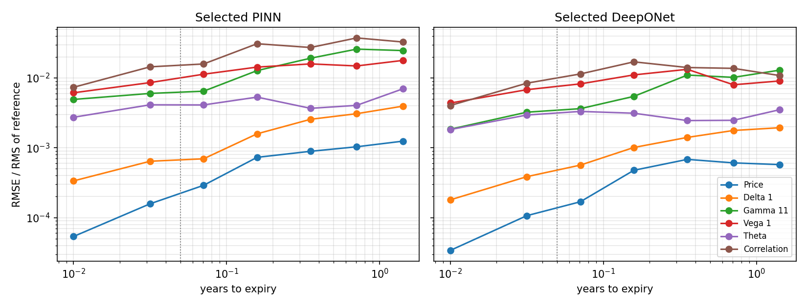

# Neural pricers for two-stock basket options: PINN and DeepONet

Two neural pricers for European arithmetic basket options on two correlated stocks, each built as a ladder in which every level adds one technique and is scored on the same validation contracts. The pre-declared rule selected **`P10_anchored`** for the PINN and **`D9_ensemble`** for the DeepONet; both were frozen by hash (2026-10-03 17:36 UTC) before being scored once on the frozen two-stock test set, then benchmarked against Monte Carlo with their Greeks validated.

## Results at a glance

Validation scores are on 4,096 fresh contracts of the training domain and 4,096 short-maturity contracts; RMSEs and timings are on the frozen test set (248 cases), price and all ten Greeks per contract, one CPU thread, in a batch of that panel's size. Training seconds are those of the selected pricer, including the levels it was warm-started from, and of the whole ladder, the full development cost; prices with Greeks in batches of 4,096 take the time per contract given in the benchmark section.

| Pricer | Validation score | Short-maturity score | Price RMSE | Gamma 11 RMSE | Theta RMSE | Microseconds per contract | Training s (selected) | Training s (ladder) |
| --- | ---: | ---: | ---: | ---: | ---: | ---: | ---: | ---: |
| PINN `P10_anchored` | 0.013 | 0.00476 | 0.0491 | 0.000249 | 0.0963 | 73.7 | 20,095 | 76,657 |
| DeepONet `D9_ensemble` | 0.00606 | 0.00294 | 0.032 | 0.000218 | 0.063 | 338 | 58,123 | 120,148 |
| Plain Monte Carlo, 1,000,000 paths |  |  | 0.0205 | 4.43e-05 | 0.0293 | 3.55e+05 | 0 | 0 |
| Sobol RQMC engine, 65,536 draws |  |  | 0.00124 | 2.25e-07 | 0.0012 | 8.28e+05 | 0 | 0 |
| ADI grid, Richardson, 160 intervals |  |  | 5.96e-05 | 3.29e-06 | 0.000182 | 1.56e+08 | 0 | 0 |

## Findings

- **Both ladders improved on the textbook network by more than an order of magnitude** on the
  validation score: PINN 0.287 to 0.0130 (`P0` to `P10`), DeepONet 0.193 to 0.0061 (`D0` to `D9`).
- **The largest gains came from the structure of the problem, not from the optimizer.** The exact
  payoff through the Levy approximation, the boundary-layer coordinate and the enveloped correction
  each changed the score by a third to a factor of five. Among optimizers, L-BFGS was the one that
  mattered (-40% for the PINN); Newton-CG added little.
- **In the training domain both pricers beat plain Monte Carlo with 1,000,000 paths on the price**
  (test RMSE 0.015 for the PINN and 0.0088 for the DeepONet against 0.020) and land between
  100,000 and 1,000,000 paths on the Greeks. They return the price and all ten Greeks in 17 and
  128 microseconds per contract in batches of 4,096, against 0.36 s for that Monte Carlo.
- **The repository's Sobol RQMC engine stays far more accurate** (price RMSE 0.0012 at 65,536
  draws, 0.83 s per contract). The neural pricers win on speed only, and only once their training
  (hours here) is spread over many contracts.
- **The ADI grid solver is the most accurate method here** (price RMSE 6.0e-5 at 160 intervals with
  Richardson extrapolation, 3.1e-3 at 40) but the slowest (3 to 156 s per contract with all
  Greeks), and it is limited to two stocks. Its Theta comes from the PDE itself, so its PDE
  residual check is zero by construction.
- **Outside the training domain the errors grow mainly for correlation and volatility.** Rate,
  dividend, moneyness and maturity extrapolate well because the exact reduction maps them back into
  the trained coordinates.
- **The DeepONet beats the PINN at every comparable stage.** The best pure-physics PINN (`P9`,
  no reference values at all) scored 0.0173; the selected PINN is the anchored hybrid `P10`.
- **The ensemble improved validation by 12% but not the test set** (test score 0.0215 against 0.0208
  for the single `D8`); the selection was frozen before the test set was opened.
- **No-arbitrage:** after the enveloped correction, no test price falls below its intrinsic value and
  no Delta leaves its bounds; a few Gamma matrices (9 PINN and 15 DeepONet of 248 cases) have a
  slightly negative smaller eigenvalue, since the true matrix is nearly rank one.
- **Against Monte Carlo intervals** the neural Greeks sit inside the 95% interval for 65-89% of
  cases at 100,000 paths and 38-81% at 1,000,000 paths, against 92-96% for the reference: Monte
  Carlo at those path counts can detect the neural errors, which the exact-reference RMSEs quantify.

## Problem

European arithmetic basket calls and puts on two correlated stocks under risk-neutral GBM, with strike
100, constant rate, dividend yields, volatilities and correlation. A contract has ten inputs: two
spots (as moneyness S_i/K), time to expiry, rate, two dividend yields, two volatilities, the
correlation and the first weight (the second is one minus it). The pricers return the price and ten
Greeks: both Deltas, the three spot Gammas, both Vegas, Theta (calendar time, per year), rate rho
and the correlation sensitivity, all per unit decimal change.

The training domain is the one of the frozen test-set protocol (`experiments/config/protocol/test_set_v1.json`):

| Parameter | Training domain |
| --- | --- |
| moneyness 1 | 0.7 to 1.3 |
| moneyness 2 | 0.7 to 1.3 |
| tau | 0.05 to 2 |
| volatility 1 | 0.1 to 0.6 |
| volatility 2 | 0.1 to 0.6 |
| correlation | -0.8 to 0.9 |
| rate | -0.02 to 0.1 |
| dividend 1 | 0 to 0.06 |
| dividend 2 | 0 to 0.06 |
| weight 1 | 0.2 to 0.8 |

## Exact reduction shared by both families

The call is homogeneous of degree one in spots and strike, the weights only scale the spots, and
rates and dividends only enter through the forwards and the discount factor, so

    C = K exp(-r tau) c(z, s, tau; sigma_1, sigma_2, rho),
    f_i = w_i S_i exp((r - q_i) tau) / K,  z = log(f_1 + f_2),  s = f_1 / (f_1 + f_2),

and in y_i = log f_i the normalized call solves the driftless PDE

    c_tau = 1/2 sigma_1^2 (c_11 - c_1) + rho sigma_1 sigma_2 c_12 + 1/2 sigma_2^2 (c_22 - c_2),
    c(tau = 0) = (exp(z) - 1)^+.

Puts follow from exact put-call parity. Ten inputs become three coordinates and three parameters,
and every Greek is obtained by automatic differentiation of the currency price through this map
(`price_and_greeks` in `src/neural/reference.py`). The PDE is posed on z in [-3, 2.5] and s in
[0.01, 0.99]; the training domain maps into z in [-0.52, 0.46], so the far boundary sits well away
from it, as a grid solver's would. The volatility, correlation and maturity ranges are the
protocol's; the PDE starts at the payoff, so physics collocation covers maturities from 0 to 2
years, while every labelled contract lies inside the training domain.

## The two families

**PINN** (`src/neural/pinn.py`): one tanh MLP trained on the residual of the pricing PDE at
collocation points, with the payoff imposed exactly or softly and the far boundary softly. No
reference labels, except in the final anchored level.

**DeepONet** (`src/neural/deeponet.py`): a branch net on the contract's model parameters and a trunk
net on where the price is evaluated, combined by an inner product (Lu et al., 2021). After the
reduction the branch sees (sigma_1, sigma_2, rho) and the trunk (z, s, tau). It is trained on
reference labels from the batched conditional quadrature (`src/neural/reference.py`, the twin of
the adaptive quadrature in `src/basket`), optionally with their derivatives and the PDE residual.

Both families share the output constructions in `src/neural/networks.py`, the PDE residuals in
`src/neural/pde.py` and the trainer in `src/neural/training.py`: Adam with an exponentially decaying
rate, residual-based adaptive sampling, L-BFGS, and the Nystrom Newton-CG optimizer of the 1D study.

## Data, seeds and selection

| Set | Contracts | Seed | Use |
|---|---:|---:|---|
| DeepONet labels | 32,768 (131,072 for the scale-up) | 7001 | training |
| PINN anchors | 4,096 | 7002 | training of the anchored level only |
| Monitor | 512 | 7201 | checkpoint choice within a run |
| Validation | 4,096 | 7301 | comparing levels; selection |
| Short-maturity validation | 4,096 (tau 0.005-0.05) | 7302 | reported, not used for selection |
| Frozen test set | 248 | 20261010 | final assessment, once |

All but the test set are scrambled Sobol draws from the protocol's training domain, calls and puts
alternating, with references from the batched quadrature. Within each family the level with the lowest validation score is selected. Score = mean over price and the ten Greeks of RMSE / RMS(reference) on the 4,096 validation contracts drawn from the protocol's training domain. A level within 1% of the best score yields to the earlier level.

## PINN ladder

| Level | Technique added | Parameters | Validation score | Short-maturity score | Price RMSE | Delta 1 RMSE | Gamma 11 RMSE | Vega 1 RMSE | Theta RMSE | Correlation RMSE | Training s |
| --- | --- | ---: | ---: | ---: | ---: | ---: | ---: | ---: | ---: | ---: | ---: |
| `P0_vanilla` | Textbook PINN: MLP on the ten raw contract inputs plus a put flag; PDE residual in spot coordinates on the training box; soft payoff loss; Adam | 13,313 | 0.287 | 0.842 | 1.62 | 0.0655 | 0.00241 | 3.9 | 2.12 | 1 | 5,340 |
| `P1_reduced` | Exact symmetry reduction: forward log-moneyness z, weight share s, tau and (sigma_1, sigma_2, rho); driftless PDE; put-call parity; far boundary at Levy values | 12,993 | 0.301 | 0.812 | 1.6 | 0.0423 | 0.00258 | 4.98 | 1.91 | 1.58 | 4,727 |
| `P2_hard_payoff` | Hard terminal condition: c = Levy + tau * N(z, s, sqrt(tau), sigma, rho), so the payoff holds exactly and the network learns the correction | 12,993 | 0.0599 | 0.0133 | 0.259 | 0.00867 | 0.000354 | 1.6 | 0.235 | 0.425 | 5,897 |
| `P3_time_balanced` | Loss balancing: residual weighted by tau / tau_max against the 1/sqrt(tau) blow-up at the strike, with collocation tau = tau_max u^2 | 12,993 | 0.0618 | 0.0146 | 0.262 | 0.0087 | 0.000354 | 1.71 | 0.236 | 0.44 | 5,949 |
| `P4_adaptive` | Residual-based adaptive sampling (RAD): every 1000 steps keep 32,768 of 131,072 candidates drawn with probability proportional to |residual| / mean + 1 | 12,993 | 0.0568 | 0.0148 | 0.226 | 0.00803 | 0.000353 | 1.51 | 0.208 | 0.386 | 5,958 |
| `P5_similarity` | Boundary-layer coordinate: the network also sees tanh(d / 3) with d = z / (Levy total volatility), the variable in which the near-expiry correction to Levy settles | 13,057 | 0.0375 | 0.0134 | 0.114 | 0.00463 | 0.00029 | 0.749 | 0.12 | 0.327 | 5,566 |
| `P6_lbfgs` | Quasi-Newton polish: full-batch L-BFGS (strong Wolfe line search) warm-started from P5 on 16,384 RAD-selected collocation points | 13,057 | 0.0227 | 0.00901 | 0.0594 | 0.00207 | 0.000169 | 0.54 | 0.0682 | 0.218 | 4,395 |
| `P7_nncg` | Second-order refinement: Nystrom-preconditioned Newton-CG (Rathore et al., 2024; from the 1D study) warm-started from P6 | 13,057 | 0.0219 | 0.00826 | 0.0569 | 0.00207 | 0.000173 | 0.469 | 0.0639 | 0.203 | 808 |
| `P8_scale_up` | Scale up: width 128 and 25,000 Adam steps from a fresh start, then 1,000 L-BFGS iterations and 20 Newton-CG steps | 50,689 | 0.0261 | 0.00986 | 0.0722 | 0.00251 | 0.000191 | 0.564 | 0.0783 | 0.234 | 17,921 |
| `P9_envelope` | Enveloped correction: c = Levy + tau * phi(d_2) * N, which fades like the time value away from the strike; trained from a fresh start through the Adam, L-BFGS and Newton-CG stages | 13,057 | 0.0172 | 0.00587 | 0.0381 | 0.00155 | 0.000168 | 0.366 | 0.0453 | 0.145 | 16,623 |
| `P10_anchored` **(selected)** | Anchored (hybrid) PINN, as in the 1D study: fine-tune P9 with the PDE residual plus reference prices at 4,096 anchor contracts of the training domain (their own seed), then L-BFGS | 13,057 | 0.013 | 0.00476 | 0.0197 | 0.00106 | 0.000121 | 0.26 | 0.0327 | 0.111 | 3,472 |

What each step showed:

- **Reduction alone (P1) did not help**: with a soft payoff the network must learn the kink at expiry
  over a wide spatial domain, and it scored no better than the textbook PINN.
- **The exact payoff (P2) was the decisive step** (0.30 to 0.060): the Levy approximation carries the
  payoff and most of the price, and the network only learns the correction.
- **Loss balancing (P3) and adaptive sampling (P4) moved little.** The residual stayed near the
  Levy approximation's own residual: that residual does not vanish near expiry but settles as a
  function of d = z / (total volatility), a structure an MLP in z cannot follow as tau -> 0.
- **The boundary-layer coordinate (P5)** gave the network d directly and cut the score by a third.
- **L-BFGS (P6) cut it by another 40%**; Nystrom Newton-CG (P7) added 4% at a quarter of the cost.
- **Width 128 (P8)** trained from scratch did worse than P7 within the same budget: a wider net
  needs more steps than the scale-up allowed.
- **The enveloped correction (P9)** scales the network by the Levy call's sensitivity to total
  volatility, so it fades like the time value away from the strike; it beat P7 by 20% and halved
  the short-maturity error.
- **Anchors (P10)**, reference prices at 4,096 contracts of their own seed added to the PDE loss as
  in the 1D study's anchored PINN, cut the score by another quarter. P10 is a hybrid: the only PINN
  level that sees reference values.

## DeepONet ladder

| Level | Technique added | Parameters | Validation score | Short-maturity score | Price RMSE | Delta 1 RMSE | Gamma 11 RMSE | Vega 1 RMSE | Theta RMSE | Correlation RMSE | Training s |
| --- | --- | ---: | ---: | ---: | ---: | ---: | ---: | ---: | ---: | ---: | ---: |
| `D0_vanilla` | Textbook DeepONet: branch on the seven raw contract parameters plus a put flag, trunk on (S_1/K, S_2/K, tau); price labels from the reference; Adam | 34,113 | 0.193 | 1 | 0.257 | 0.0209 | 0.00257 | 1.73 | 1.17 | 0.477 | 458 |
| `D1_reduced` | Exact symmetry reduction: branch on (sigma_1, sigma_2, rho), trunk on (z, s, tau); put-call parity | 33,793 | 0.14 | 0.748 | 0.188 | 0.0142 | 0.00172 | 1.49 | 1.2 | 0.399 | 447 |
| `D2_hard_payoff` | Hard terminal condition: c = Levy + tau * <branch, trunk(z, s, sqrt(tau))> | 33,793 | 0.0313 | 0.0127 | 0.0591 | 0.00354 | 0.000299 | 0.64 | 0.0891 | 0.206 | 461 |
| `D3_differential` | Differential (Sobolev) training: add the nine derivative labels in (y_1, y_2, tau, sigma_1, sigma_2, rho), first and second order in the log forwards | 33,793 | 0.0161 | 0.0137 | 0.0269 | 0.00171 | 0.000167 | 0.309 | 0.055 | 0.0838 | 4,265 |
| `D4_physics` | Physics-informed DeepONet: add the PDE residual on unlabelled collocation over the whole computational domain (tau from 0) and the far-boundary condition | 33,793 | 0.0158 | 0.0135 | 0.0263 | 0.00165 | 0.000168 | 0.302 | 0.0541 | 0.0799 | 7,789 |
| `D5_similarity` | Boundary-layer coordinate in the trunk: tanh(z / (3 sigma_ref sqrt(tau))) with sigma_ref = 0.35, so the trunk still sees coordinates only | 33,857 | 0.0134 | 0.00804 | 0.0227 | 0.00133 | 0.000139 | 0.282 | 0.0411 | 0.0738 | 11,306 |
| `D6_lbfgs` | Quasi-Newton polish: full-batch L-BFGS warm-started from D5 on 4,096 labelled contracts and 4,096 collocation points | 33,857 | 0.0114 | 0.00862 | 0.0174 | 0.00113 | 0.000119 | 0.226 | 0.035 | 0.0667 | 2,213 |
| `D7_scale_up` | Scale up: width and rank 128 and 131,072 labelled contracts from a fresh start, then the L-BFGS stage of D6 | 133,249 | 0.0112 | 0.00844 | 0.0176 | 0.00108 | 0.000118 | 0.212 | 0.0336 | 0.0668 | 18,405 |
| `D8_envelope` | Enveloped correction: c = Levy + tau * phi(d_2) * <branch, trunk>, trained from a fresh start through the Adam and L-BFGS stages | 33,857 | 0.00685 | 0.00295 | 0.0112 | 0.00063 | 6.26e-05 | 0.152 | 0.0203 | 0.0486 | 16,681 |
| `D9_ensemble` **(selected)** | Ensemble: average of four independently seeded D8 trainings (seeds 0-3); Greeks are member averages | 135,428 | 0.00606 | 0.00294 | 0.0101 | 0.000555 | 5.82e-05 | 0.138 | 0.0191 | 0.039 | 58,123 |

What each step showed:

- **Reduction (D1)** helped modestly; **the exact payoff (D2)** was again the largest single step.
- **Derivative labels (D3)** halved the score: the Greeks are what the score measures, and the
  labels supervise them directly.
- **The PDE residual (D4)** added 2%; the labels already pin the solution.
- **The boundary-layer coordinate in the trunk (D5)** helped most at short maturities (-40%).
- **L-BFGS (D6)** cut the score by 15%; **width and rank 128 with four times the data (D7)** matched
  it from scratch.
- **The enveloped correction (D8)** cut the score by 40% and the short-maturity score by two thirds.
- **The four-seed ensemble (D9)** averages independent trainings of D8.

## Frozen test set

`results/test_set_v1` (248 cases: 128 interpolation, 32 short-maturity, 72 extrapolation, 16 anchor) was verified against its seal before scoring. Every development contract differs from every test case by at least 0.0792 of some parameter's range, and the batched quadrature that labelled the training data reproduces the sealed references to a worst relative difference of 1.22e-05 (in the bumped sensitivities; prices, Deltas and Gammas agree to about 1e-12).

**PINN (`P10_anchored`).** RMSE by split, with the largest absolute error and the median relative error (test-set floors) over all 248 cases:

| Quantity | Interpolation | Short maturity | Extrapolation | Anchor | Largest error | Median relative |
| --- | ---: | ---: | ---: | ---: | ---: | ---: |
| Price | 0.0149 | 0.00104 | 0.0888 | 0.012 | 0.482 | 0.000828 |
| Delta 1 | 0.000826 | 0.000195 | 0.004 | 0.000569 | 0.0227 | 0.00208 |
| Delta 2 | 0.00105 | 0.000139 | 0.00501 | 0.000843 | 0.0271 | 0.00211 |
| Gamma 11 | 8.12e-05 | 5.34e-05 | 0.000442 | 0.000142 | 0.00352 | 0.00771 |
| Gamma 12 | 5.65e-05 | 3.23e-05 | 0.000379 | 6.75e-05 | 0.0027 | 0.00598 |
| Gamma 22 | 9.78e-05 | 4.42e-05 | 0.00053 | 2.83e-05 | 0.00287 | 0.00683 |
| Vega 1 | 0.172 | 0.0141 | 0.385 | 0.279 | 1.35 | 0.00879 |
| Vega 2 | 0.243 | 0.00955 | 0.852 | 0.259 | 4.79 | 0.01 |
| Theta | 0.0572 | 0.0643 | 0.155 | 0.0223 | 0.943 | 0.00366 |
| Rate rho | 0.197 | 0.0012 | 1.47 | 0.0625 | 9.71 | 0.00158 |
| Correlation | 0.0581 | 0.00331 | 0.465 | 0.115 | 3.23 | 0.0104 |

**DeepONet (`D9_ensemble`).** RMSE by split, with the largest absolute error and the median relative error (test-set floors) over all 248 cases:

| Quantity | Interpolation | Short maturity | Extrapolation | Anchor | Largest error | Median relative |
| --- | ---: | ---: | ---: | ---: | ---: | ---: |
| Price | 0.00878 | 0.000807 | 0.0581 | 0.00565 | 0.265 | 0.00042 |
| Delta 1 | 0.000502 | 0.000122 | 0.00138 | 0.000775 | 0.00553 | 0.000718 |
| Delta 2 | 0.000524 | 0.000105 | 0.00225 | 0.000341 | 0.0137 | 0.000748 |
| Gamma 11 | 6.43e-05 | 4.46e-05 | 0.000394 | 4.9e-05 | 0.00296 | 0.00552 |
| Gamma 12 | 2.52e-05 | 3e-05 | 0.000297 | 1.14e-05 | 0.00225 | 0.0027 |
| Gamma 22 | 4.44e-05 | 2.86e-05 | 0.00036 | 1.95e-05 | 0.00227 | 0.00413 |
| Vega 1 | 0.105 | 0.00806 | 0.367 | 0.18 | 1.8 | 0.00468 |
| Vega 2 | 0.114 | 0.00627 | 0.56 | 0.155 | 2.96 | 0.0052 |
| Theta | 0.0449 | 0.0558 | 0.0932 | 0.00831 | 0.646 | 0.00144 |
| Rate rho | 0.0864 | 0.000564 | 0.537 | 0.0803 | 2.99 | 0.000656 |
| Correlation | 0.0237 | 0.00217 | 0.53 | 0.0168 | 2.77 | 0.00448 |

Test score (mean over price and the ten Greeks of RMSE / RMS of the reference) of every pricer, by split; the ladder levels are shown for context only, the selection was frozen before the test set was opened:

| Pricer | Interpolation | Short maturity | Extrapolation | Anchor | All cases | Microseconds per contract |
| --- | ---: | ---: | ---: | ---: | ---: | ---: |
| `pinn_selected` | 0.01 | 0.00441 | 0.0511 | 0.00935 | 0.0265 | 73.9 |
| `deeponet_selected` | 0.00541 | 0.00305 | 0.0416 | 0.00391 | 0.0215 | 411 |
| `levy_approximation` | 0.0729 | 0.0109 | 0.147 | 0.0401 | 0.0938 | 32.2 |
| `D0_vanilla` | 0.276 | 1.75 | 0.381 | 0.305 | 0.363 | 50.5 |
| `D1_reduced` | 0.115 | 0.824 | 0.298 | 0.267 | 0.273 | 43.5 |
| `D2_hard_payoff` | 0.027 | 0.0114 | 0.0842 | 0.0189 | 0.0463 | 82 |
| `D3_differential` | 0.0156 | 0.014 | 0.0619 | 0.0104 | 0.0331 | 75.1 |
| `D4_physics` | 0.0159 | 0.0137 | 0.0598 | 0.00888 | 0.0322 | 89.1 |
| `D5_similarity` | 0.0132 | 0.00736 | 0.0587 | 0.00918 | 0.0308 | 83.6 |
| `D6_lbfgs` | 0.0107 | 0.00778 | 0.0639 | 0.0063 | 0.0332 | 90.1 |
| `D7_scale_up` | 0.0113 | 0.00818 | 0.0542 | 0.00934 | 0.0284 | 110 |
| `D8_envelope` | 0.0055 | 0.00326 | 0.0399 | 0.00351 | 0.0208 | 87.8 |
| `D9_ensemble` | 0.00541 | 0.00305 | 0.0416 | 0.00391 | 0.0215 | 1.15e+03 |
| `P0_vanilla` | 0.288 | 0.853 | 0.401 | 0.342 | 0.392 | 26.2 |
| `P10_anchored` | 0.01 | 0.00441 | 0.0511 | 0.00935 | 0.0265 | 73.5 |
| `P1_reduced` | 0.286 | 0.87 | 0.365 | 0.399 | 0.4 | 27.2 |
| `P2_hard_payoff` | 0.0559 | 0.0133 | 0.116 | 0.0342 | 0.0729 | 90.1 |
| `P3_time_balanced` | 0.0575 | 0.0154 | 0.118 | 0.0351 | 0.0748 | 70.1 |
| `P4_adaptive` | 0.0541 | 0.0155 | 0.111 | 0.0348 | 0.0699 | 74.3 |
| `P5_similarity` | 0.0358 | 0.015 | 0.083 | 0.0258 | 0.0504 | 61.6 |
| `P6_lbfgs` | 0.0202 | 0.0094 | 0.0603 | 0.0177 | 0.0344 | 61.4 |
| `P7_nncg` | 0.0185 | 0.00834 | 0.0546 | 0.0136 | 0.031 | 63.3 |
| `P8_scale_up` | 0.0211 | 0.00995 | 0.0635 | 0.0144 | 0.0363 | 94.8 |
| `P9_envelope` | 0.0139 | 0.00554 | 0.0507 | 0.0126 | 0.0277 | 80.8 |

## Benchmark against Monte Carlo, RQMC and ADI

Plain Monte Carlo uses pseudo-random exact GBM draws with pathwise first-order Greeks and likelihood-ratio/pathwise Gammas (`src/neural/monte_carlo.py`); the RQMC engine is `rqmc_estimate` in `src/pricing` (conditional estimator, geometric control, 16 scrambles, bumped parameter sensitivities). ADI is the two-stock grid solver `adi_values` in `src/pricing` (modified Craig-Sneyd, Richardson extrapolation over the grid and its nested doubling, PDE Theta, bumped Vega, rho and correlation sensitivities), with grid sizes fixed in advance from the engine-validation study (`experiments/neural/benchmark_adi.py`). Seconds per contract include all Greeks, one thread.

Neural evaluation, one thread. PINN: 16.6 microseconds per contract for the price and all ten Greeks in a batch of 4,096, 12.4 ms for a single contract. DeepONet: 128 microseconds per contract for the price and all ten Greeks in a batch of 4,096, 43.8 ms for a single contract.

RMSE against the quadrature reference:

| Method | Draws (ADI: grid intervals) | Price | Delta 1 | Delta 2 | Gamma 11 | Gamma 12 | Gamma 22 | Vega 1 | Vega 2 | Theta | Rate rho | Correlation | Seconds per contract |
| --- | ---: | ---: | ---: | ---: | ---: | ---: | ---: | ---: | ---: | ---: | ---: | ---: | ---: |
| PINN (selected) | 0 | 0.0491 | 0.00224 | 0.00281 | 0.000249 | 0.000209 | 0.000294 | 0.252 | 0.496 | 0.0963 | 0.804 | 0.256 | 7.37e-05 |
| DeepONet (selected) | 0 | 0.032 | 0.000853 | 0.00127 | 0.000218 | 0.000161 | 0.000197 | 0.217 | 0.315 | 0.063 | 0.297 | 0.286 | 0.000338 |
| Plain Monte Carlo | 1,000 | 0.56 | 0.00735 | 0.00766 | 0.00121 | 0.00133 | 0.0016 | 1.16 | 1.24 | 0.721 | 1.45 | 0.948 | 0.000331 |
| Plain Monte Carlo | 10,000 | 0.191 | 0.00283 | 0.00272 | 0.000758 | 0.000596 | 0.000705 | 0.42 | 0.508 | 0.343 | 0.555 | 0.171 | 0.000945 |
| Plain Monte Carlo | 100,000 | 0.0679 | 0.000739 | 0.000856 | 0.000227 | 0.000308 | 0.000376 | 0.12 | 0.178 | 0.0745 | 0.152 | 0.0873 | 0.0298 |
| Plain Monte Carlo | 1,000,000 | 0.0205 | 0.000223 | 0.000265 | 4.43e-05 | 4.58e-05 | 7.7e-05 | 0.0332 | 0.0502 | 0.0293 | 0.0464 | 0.0174 | 0.355 |
| Sobol RQMC engine | 4,096 | 0.00556 | 4.81e-05 | 5.96e-05 | 1.69e-06 | 5.75e-07 | 9.2e-07 | 0.0142 | 0.0228 | 0.00538 | 0.00595 | 0.00604 | 0.336 |
| Sobol RQMC engine | 65,536 | 0.00124 | 5.4e-06 | 1.11e-05 | 2.25e-07 | 3.94e-08 | 6.28e-08 | 0.00245 | 0.00623 | 0.0012 | 0.000234 | 0.00144 | 0.828 |
| ADI grid, Richardson | 40 | 0.00308 | 0.000115 | 0.000168 | 6.76e-05 | 6.36e-05 | 5.83e-05 | 0.0133 | 0.00756 | 0.0038 | 0.0207 | 0.085 | 3.28 |
| ADI grid, Richardson | 80 | 0.000537 | 4.14e-05 | 5.39e-05 | 1.95e-05 | 1.69e-05 | 1.47e-05 | 0.00454 | 0.00257 | 0.00112 | 0.00906 | 0.0166 | 14.8 |
| ADI grid, Richardson | 160 | 5.96e-05 | 7.88e-06 | 1.04e-05 | 3.29e-06 | 2.78e-06 | 2.22e-06 | 0.000914 | 0.000489 | 0.000182 | 0.00185 | 0.00203 | 156 |

Median absolute error against the quadrature reference:

| Method | Draws (ADI: grid intervals) | Price | Delta 1 | Delta 2 | Gamma 11 | Gamma 12 | Gamma 22 | Vega 1 | Vega 2 | Theta | Rate rho | Correlation |
| --- | ---: | ---: | ---: | ---: | ---: | ---: | ---: | ---: | ---: | ---: | ---: | ---: |
| PINN (selected) | 0 | 0.00604 | 0.000364 | 0.00035 | 1.64e-05 | 1.29e-05 | 1.66e-05 | 0.0636 | 0.0609 | 0.0159 | 0.0495 | 0.0169 |
| DeepONet (selected) | 0 | 0.0032 | 0.000112 | 0.000128 | 1.08e-05 | 5.81e-06 | 1e-05 | 0.0336 | 0.0258 | 0.00629 | 0.0183 | 0.00741 |
| Plain Monte Carlo | 1,000 | 0.21 | 0.00364 | 0.0035 | 0.000216 | 0.000224 | 0.000229 | 0.388 | 0.429 | 0.154 | 0.619 | 0.149 |
| Plain Monte Carlo | 10,000 | 0.0576 | 0.00126 | 0.00117 | 9.01e-05 | 6.13e-05 | 7.1e-05 | 0.132 | 0.132 | 0.047 | 0.186 | 0.0541 |
| Plain Monte Carlo | 100,000 | 0.023 | 0.000338 | 0.000353 | 2.89e-05 | 2.21e-05 | 2.42e-05 | 0.0325 | 0.0413 | 0.0177 | 0.0498 | 0.0152 |
| Plain Monte Carlo | 1,000,000 | 0.00571 | 0.000112 | 0.000113 | 8.22e-06 | 6.15e-06 | 7.03e-06 | 0.0105 | 0.0108 | 0.00494 | 0.0152 | 0.00451 |
| Sobol RQMC engine | 4,096 | 0.000295 | 5.43e-06 | 6.31e-06 | 1.38e-07 | 7.71e-08 | 1.33e-07 | 0.00109 | 0.00101 | 0.000503 | 0.000504 | 0.000546 |
| Sobol RQMC engine | 65,536 | 1.89e-05 | 2.96e-07 | 3.13e-07 | 6.9e-09 | 3.54e-09 | 8.1e-09 | 6.32e-05 | 5.98e-05 | 2.96e-05 | 2.75e-05 | 3.65e-05 |
| ADI grid, Richardson | 40 | 0.000115 | 4.97e-06 | 5.52e-06 | 5.09e-07 | 3.32e-07 | 4.32e-07 | 0.000544 | 0.000571 | 0.000205 | 0.000524 | 0.000199 |
| ADI grid, Richardson | 80 | 1.82e-05 | 8.19e-07 | 8.49e-07 | 6.22e-08 | 4.52e-08 | 4.85e-08 | 8.08e-05 | 7.67e-05 | 2.49e-05 | 5.95e-05 | 2.73e-05 |
| ADI grid, Richardson | 160 | 2.43e-06 | 1.03e-07 | 9.24e-08 | 7.16e-09 | 6.03e-09 | 7.05e-09 | 1.01e-05 | 1.03e-05 | 3.23e-06 | 7.9e-06 | 3.95e-06 |

RMSE on the 128 interpolation cases only (inside the training domain), where the neural pricers are meant to be used:

| Method | Draws (ADI: grid intervals) | Price | Delta 1 | Delta 2 | Gamma 11 | Gamma 12 | Gamma 22 | Vega 1 | Vega 2 | Theta | Rate rho | Correlation |
| --- | ---: | ---: | ---: | ---: | ---: | ---: | ---: | ---: | ---: | ---: | ---: | ---: |
| PINN (selected) | 0 | 0.0149 | 0.000826 | 0.00105 | 8.12e-05 | 5.65e-05 | 9.78e-05 | 0.172 | 0.243 | 0.0572 | 0.197 | 0.0581 |
| DeepONet (selected) | 0 | 0.00878 | 0.000502 | 0.000524 | 6.43e-05 | 2.52e-05 | 4.44e-05 | 0.105 | 0.114 | 0.0449 | 0.0864 | 0.0237 |
| Plain Monte Carlo | 1,000 | 0.542 | 0.00762 | 0.00781 | 0.000571 | 0.000443 | 0.000642 | 1.15 | 1.22 | 0.465 | 1.52 | 0.409 |
| Plain Monte Carlo | 10,000 | 0.192 | 0.0031 | 0.00289 | 0.000215 | 0.000197 | 0.000552 | 0.466 | 0.509 | 0.129 | 0.624 | 0.141 |
| Plain Monte Carlo | 100,000 | 0.0712 | 0.000773 | 0.000874 | 7.47e-05 | 5.39e-05 | 8.91e-05 | 0.127 | 0.161 | 0.0404 | 0.165 | 0.0626 |
| Plain Monte Carlo | 1,000,000 | 0.0203 | 0.000214 | 0.000269 | 2.11e-05 | 1.86e-05 | 3.97e-05 | 0.0371 | 0.0574 | 0.0134 | 0.0436 | 0.0166 |
| ADI grid, Richardson | 40 | 0.000356 | 2.15e-05 | 1.58e-05 | 2.29e-06 | 2.2e-06 | 4.09e-06 | 0.00238 | 0.00248 | 0.000721 | 0.00256 | 0.000692 |
| ADI grid, Richardson | 80 | 6.8e-05 | 4.95e-06 | 2.36e-06 | 2.95e-07 | 2.42e-07 | 3.78e-07 | 0.000307 | 0.000338 | 8.42e-05 | 0.000428 | 9.3e-05 |
| ADI grid, Richardson | 160 | 1.66e-05 | 7.12e-07 | 4.28e-07 | 5.81e-08 | 2.6e-08 | 3.43e-08 | 6.64e-05 | 5.79e-05 | 1.11e-05 | 7.39e-05 | 2.37e-05 |

Plain Monte Carlo paths needed to match each neural RMSE, extrapolated from 1,000,000 paths with the 1/sqrt(N) law:

| Quantity | MC RMSE at 1,000,000 paths | PINN RMSE | Equivalent paths (PINN) | DeepONet RMSE | Equivalent paths (DeepONet) |
| --- | ---: | ---: | ---: | ---: | ---: |
| Price | 0.0205 | 0.0491 | 173,378 | 0.032 | 410,216 |
| Delta 1 | 0.000223 | 0.00224 | 9,871 | 0.000853 | 68,257 |
| Delta 2 | 0.000265 | 0.00281 | 8,916 | 0.00127 | 43,387 |
| Gamma 11 | 4.43e-05 | 0.000249 | 31,783 | 0.000218 | 41,253 |
| Gamma 12 | 4.58e-05 | 0.000209 | 47,908 | 0.000161 | 80,546 |
| Gamma 22 | 7.7e-05 | 0.000294 | 68,456 | 0.000197 | 153,111 |
| Vega 1 | 0.0332 | 0.252 | 17,428 | 0.217 | 23,512 |
| Vega 2 | 0.0502 | 0.496 | 10,248 | 0.315 | 25,349 |
| Theta | 0.0293 | 0.0963 | 92,677 | 0.063 | 216,600 |
| Rate rho | 0.0464 | 0.804 | 3,325 | 0.297 | 24,388 |
| Correlation | 0.0174 | 0.256 | 4,637 | 0.286 | 3,707 |

Greek validation against Monte Carlo: share of cases whose value lies inside the plain Monte Carlo 95% interval. The reference column checks the intervals themselves; a neural share near it means the neural error is small next to the Monte Carlo error at that path count.

| Paths | Quantity | Reference | PINN | DeepONet |
| --- | ---: | ---: | ---: | ---: |
| 100,000 | Price | 92.3% | 88.7% | 87.5% |
| 100,000 | Delta 1 | 94.0% | 74.6% | 82.3% |
| 100,000 | Delta 2 | 93.1% | 76.2% | 79.8% |
| 100,000 | Gamma 11 | 92.3% | 76.2% | 78.2% |
| 100,000 | Gamma 12 | 93.5% | 80.6% | 84.7% |
| 100,000 | Gamma 22 | 91.5% | 73.4% | 79.0% |
| 100,000 | Vega 1 | 93.5% | 69.0% | 72.6% |
| 100,000 | Vega 2 | 91.9% | 64.9% | 74.6% |
| 100,000 | Theta | 93.5% | 77.0% | 82.7% |
| 100,000 | Rate rho | 92.3% | 74.6% | 81.5% |
| 100,000 | Correlation | 92.7% | 71.4% | 80.2% |
| 1,000,000 | Price | 94.8% | 69.0% | 81.5% |
| 1,000,000 | Delta 1 | 95.2% | 48.4% | 71.4% |
| 1,000,000 | Delta 2 | 94.8% | 48.4% | 65.7% |
| 1,000,000 | Gamma 11 | 92.7% | 56.0% | 61.7% |
| 1,000,000 | Gamma 12 | 96.0% | 59.3% | 74.6% |
| 1,000,000 | Gamma 22 | 93.1% | 56.5% | 64.1% |
| 1,000,000 | Vega 1 | 92.3% | 38.7% | 52.0% |
| 1,000,000 | Vega 2 | 92.3% | 37.9% | 51.2% |
| 1,000,000 | Theta | 94.0% | 47.2% | 69.8% |
| 1,000,000 | Rate rho | 94.0% | 52.4% | 71.0% |
| 1,000,000 | Correlation | 93.5% | 50.0% | 65.3% |

Identity and no-arbitrage checks of the Greeks. The PDE residual uses each pricer's own Theta, Deltas and Gammas in the two-asset Black-Scholes equation in spot coordinates. Delta bounds are 0 <= Delta_i <= w_i exp(-q_i tau) for calls (mirrored for puts); the Gamma matrix of a convex payoff is positive semi-definite; prices must lie between the discounted intrinsic value and the discounted forward (calls) or strike (puts). Counts use the test set's floors (1e-4 for prices and Deltas, 1e-7 for Gammas); brackets give the worst size.

| Panel | Pricer | Contracts | PDE residual RMSE / Theta RMS | Delta outside bounds (worst) | Gamma not PSD (most negative eigenvalue) | Price below intrinsic (worst) | Price above bound |
| --- | ---: | ---: | ---: | ---: | ---: | ---: | ---: |
| test | pinn | 248 | 0.0186 | 0 (3.57e-24) | 9 (0.000112) | 0 (4.43e-10) | 0 |
| test | deeponet | 248 | 0.0165 | 0 (9.36e-19) | 15 (0.000217) | 0 (0) | 0 |
| test | reference | 248 | 1.65e-08 | 0 (0) | 0 (0) | 0 (0) | 0 |
| validation | pinn | 4,096 | 0.0106 | 0 (1.91e-12) | 81 (9.71e-05) | 0 (1.74e-12) | 0 |
| validation | deeponet | 4,096 | 0.00874 | 0 (2.13e-09) | 60 (0.000155) | 1 (0.008) | 0 |
| short_validation | pinn | 4,096 | 0.00485 | 0 (8.57e-07) | 2 (4.4e-07) | 0 (1.1e-06) | 0 |
| short_validation | deeponet | 4,096 | 0.00336 | 0 (4.59e-07) | 1 (1.14e-07) | 0 (1.66e-06) | 0 |
| test | adi_40 | 248 | 2.44e-16 | 0 (1.25e-07) | 12 (0.000151) | 0 (1.78e-07) | 0 |
| test | adi_80 | 248 | 2.23e-16 | 0 (1.1e-09) | 4 (9.33e-06) | 0 (2.25e-09) | 0 |
| test | adi_160 | 248 | 2.17e-16 | 0 (1.05e-11) | 1 (1.1e-06) | 0 (1.49e-11) | 0 |

## Greeks by maturity

**PINN**, RMSE / RMS of the reference by years to expiry (validation and short-maturity panels; the training domain starts at 0.05):

| Years to expiry | Contracts | Price | Delta 1 | Gamma 11 | Vega 1 | Theta | Correlation |
| --- | ---: | ---: | ---: | ---: | ---: | ---: | ---: |
| 0.005-0.02 | 1,365 | 5.37e-05 | 0.000336 | 0.00492 | 0.00613 | 0.00274 | 0.00735 |
| 0.02-0.05 | 2,731 | 0.000158 | 0.000642 | 0.006 | 0.00858 | 0.00413 | 0.0144 |
| 0.05-0.1 | 105 | 0.00029 | 0.000696 | 0.00646 | 0.0113 | 0.00411 | 0.0158 |
| 0.1-0.25 | 315 | 0.00073 | 0.00159 | 0.0127 | 0.0143 | 0.00532 | 0.0309 |
| 0.25-0.5 | 525 | 0.000891 | 0.00256 | 0.0192 | 0.0159 | 0.00367 | 0.0273 |
| 0.5-1 | 1,051 | 0.00103 | 0.00308 | 0.0259 | 0.0148 | 0.00405 | 0.0374 |
| 1-2 | 2,100 | 0.00124 | 0.00394 | 0.0247 | 0.0178 | 0.00698 | 0.0327 |

**DeepONet**, RMSE / RMS of the reference by years to expiry (validation and short-maturity panels; the training domain starts at 0.05):

| Years to expiry | Contracts | Price | Delta 1 | Gamma 11 | Vega 1 | Theta | Correlation |
| --- | ---: | ---: | ---: | ---: | ---: | ---: | ---: |
| 0.005-0.02 | 1,365 | 3.4e-05 | 0.00018 | 0.00184 | 0.00437 | 0.00183 | 0.00403 |
| 0.02-0.05 | 2,731 | 0.000107 | 0.000386 | 0.00323 | 0.00679 | 0.00295 | 0.00841 |
| 0.05-0.1 | 105 | 0.000169 | 0.000565 | 0.00363 | 0.00822 | 0.00332 | 0.0114 |
| 0.1-0.25 | 315 | 0.000477 | 0.00101 | 0.00545 | 0.0111 | 0.00313 | 0.017 |
| 0.25-0.5 | 525 | 0.000683 | 0.00141 | 0.011 | 0.0133 | 0.00245 | 0.0141 |
| 0.5-1 | 1,051 | 0.000608 | 0.00177 | 0.0102 | 0.00799 | 0.00247 | 0.0137 |
| 1-2 | 2,100 | 0.000575 | 0.00194 | 0.0129 | 0.00905 | 0.00351 | 0.0108 |

## Limits

- The model is the repository's: constant rates, dividends, volatilities and correlation under GBM,
  two stocks. The reduction is exact for this model only.
- Accuracy is measured against conditional quadrature, exact to about 1e-12 for prices here; Monte
  Carlo is a competitor, not the reference.
- Timings depend on the machine, the batch and the thread count. Training and labelling are one-off
  costs that pay off only when many contracts are priced.
- Outside the training domain the pricers extrapolate without guarantees; the test set's
  extrapolation split measures how far that goes.

## Reproduce

Run from the `2d/` folder (Windows, Python 3.13.3, NumPy 2.1.0, SciPy 1.15.3, PyTorch 2.8.0 CPU).

    python -m experiments.neural.verify_results     # hashes, then re-evaluates the frozen pricers
    python -m pytest tests -q

To retrain (hours of CPU time; each level resumes if interrupted), in ladder order:

    python -m experiments.neural.train P0_vanilla    # likewise every P* and D* level
    python -m experiments.neural.train D8_envelope --seed 1    # and seeds 2 and 3
    python -m experiments.neural.ensemble D9_ensemble
    python -m experiments.neural.select_models       # applies the rule, freezes the selection
    python -m experiments.neural.evaluate_test       # scores the frozen pricers on results/test_set_v1
    python -m experiments.neural.benchmark_monte_carlo
    python -m experiments.neural.make_report
