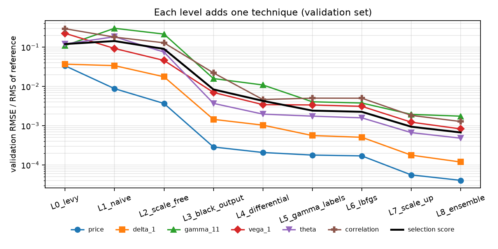
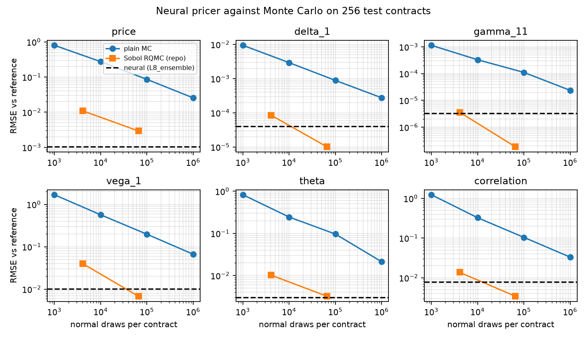
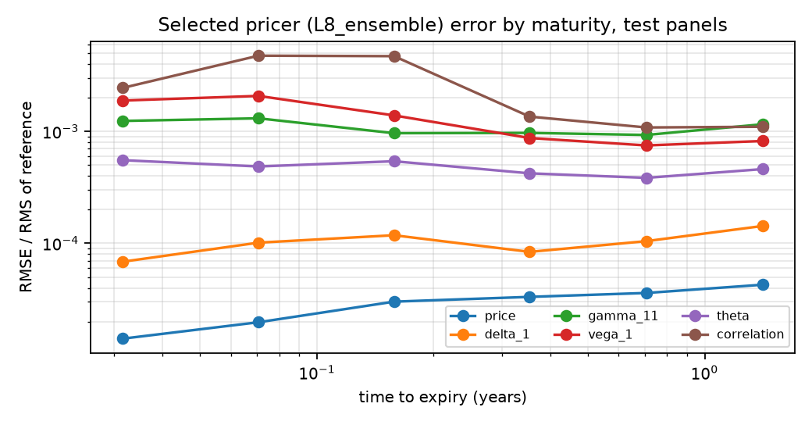

# Two-stock neural basket pricer

A neural pricer for European arithmetic basket calls and puts on two correlated stocks under risk-neutral GBM, returning the price and ten Greeks in one call. It was built as a ladder: each level adds one technique, every level is scored on the same validation set, and the pre-declared rule picks the final model. The test sets were generated and hashed before any training (protocol frozen 2026-10-02 22:14 UTC) and played no part in any choice.

**Selected pricer: `L8_ensemble`.** Reference values come from the conditional quadrature in `src/neural/reference.py`, a batched twin of the repository's `quadrature_price` that agrees with it to about 1e-12 in price; its Greeks are exact derivatives of the quadrature rule.

## Domain

Strike 100, spots 50-150, time to expiry 0.02-2.0 years, rate 0.0-0.08, dividend yields 0.0-0.05, volatilities 0.1-0.7, correlation -0.95 to 0.95, first weight 0.2-0.8. Prices are homogeneous in spots and strike, so any strike is covered by rescaling. Training contracts come from a slightly larger box with extra weight on short maturities. Puts are priced by exact put-call parity, so their absolute price and Gamma/Vega/correlation errors equal those of the matching call.

## Accuracy of the selected pricer

RMSE and largest absolute error against the reference on 8,192 fresh test contracts drawn uniformly from the domain (alternating calls and puts) and 2,048 short-maturity contracts (0.02-0.1 years). Units: currency for price, per unit spot for Delta and Gamma, per unit of volatility, rate or correlation for Vega, rho and correlation sensitivity, per year for Theta.

| Quantity | Test RMSE | Test max error | Short-maturity RMSE | Short-maturity max error |
|---|---:|---:|---:|---:|
| Price | 9.46e-04 | 0.0064 | 3.65e-04 | 0.00326 |
| Delta 1 | 4.18e-05 | 6.12e-04 | 3.90e-05 | 0.00104 |
| Delta 2 | 4.32e-05 | 9.25e-04 | 3.58e-05 | 7.19e-04 |
| Gamma 11 | 4.67e-06 | 8.65e-05 | 1.23e-05 | 3.65e-04 |
| Gamma 22 | 6.46e-06 | 2.89e-04 | 1.28e-05 | 5.14e-04 |
| Gamma 12 | 2.91e-06 | 1.09e-04 | 6.90e-06 | 2.25e-04 |
| Vega 1 | 0.0116 | 0.136 | 0.00442 | 0.104 |
| Vega 2 | 0.0108 | 0.127 | 0.00338 | 0.096 |
| Theta | 0.00311 | 0.0354 | 0.00758 | 0.0456 |
| Rate rho | 0.00817 | 0.094 | 4.49e-04 | 0.013 |
| Correlation | 0.0042 | 0.106 | 0.00273 | 0.104 |

## The ladder

Validation score = mean over price and the ten Greeks of RMSE divided by the RMS of the reference (lower is better). Training times are wall-clock seconds on a 4-core CPU; seeds of one level ran in parallel on one thread each, and ensemble times add up their members.

| Level | Technique added | Validation score | Price RMSE | Gamma 11 RMSE | Vega 1 RMSE | Theta RMSE | Correlation RMSE | Test score | Training s |
|---|---|---:|---:|---:|---:|---:|---:|---:|---:|
| `L0_levy` | Analytic Levy moment-matching approximation, no training | 0.12 | 0.808 | 5.37e-04 | 3.19 | 0.802 | 1.03 | 0.12 | 0 |
| `L1_naive` | Plain MLP on the ten raw contract inputs, price-only MSE, Adam | 0.143 | 0.212 | 0.00148 | 1.31 | 1.23 | 0.631 | 0.141 | 119 |
| `L2_scale_free` | Scale-free inputs: homogeneity, forwards and total volatility (10 inputs to 5) | 0.0901 | 0.0889 | 0.00105 | 0.651 | 0.499 | 0.452 | 0.0868 | 116 |
| `L3_black_output` | Black-formula output layer learning a basket implied-volatility ratio over Levy | 0.00838 | 0.00693 | 7.75e-05 | 0.0996 | 0.0247 | 0.0775 | 0.00901 | 131 |
| `L4_differential` | Differential training: add the five first-derivative labels | 0.00429 | 0.00502 | 5.32e-05 | 0.0488 | 0.0132 | 0.0162 | 0.00435 | 306 |
| `L5_gamma_labels` | Add second-derivative (spot Gamma) labels | 0.00242 | 0.00432 | 1.99e-05 | 0.0479 | 0.0117 | 0.0177 | 0.00237 | 1305 |
| `L6_lbfgs` | Quasi-Newton polish: full-batch L-BFGS warm-started from level 5 | 0.00226 | 0.00411 | 1.85e-05 | 0.0442 | 0.0106 | 0.0176 | 0.00224 | 1576 |
| `L7_scale_up` | Scale up: width 128, 262,144 training contracts, batch 2048 (Adam only) | 9.42e-04 | 0.00135 | 9.50e-06 | 0.0175 | 0.00445 | 0.00643 | 9.13e-04 | 7098 |
| `L8_ensemble` **(selected)** | Ensemble: average of four independently seeded level-7 networks | 6.73e-04 | 9.82e-04 | 8.55e-06 | 0.0118 | 0.00321 | 0.00448 | 6.22e-04 | 28303 |



## Benchmark against Monte Carlo

The first 256 test contracts, priced by the selected pricer, by plain Monte Carlo (pseudo-random exact GBM draws; pathwise first-order Greeks and likelihood-ratio/pathwise Gammas, `src/neural/monte_carlo.py`) and by the repository's Sobol RQMC estimators (conditional quadrature with the geometric control, 16 scrambles; bumped Vega, Theta, rho and correlation). Errors are RMSE against the reference. Seconds are wall-clock per contract on one machine and include all Greeks.

| Method | Normal draws | Price | Delta 1 | Gamma 11 | Vega 1 | Theta | Correlation | Seconds per contract |
|---|---:|---:|---:|---:|---:|---:|---:|---:|
| Neural (selected) | 0 | 0.00103 | 4.00e-05 | 3.28e-06 | 0.0102 | 0.00301 | 0.0078 | 8.8e-05 |
| Plain MC | 1,000 | 0.799 | 0.00941 | 0.00114 | 1.69 | 0.825 | 1.23 | 0.00023 |
| Plain MC | 10,000 | 0.275 | 0.00293 | 3.29e-04 | 0.567 | 0.244 | 0.325 | 0.0025 |
| Plain MC | 100,000 | 0.0857 | 8.86e-04 | 1.11e-04 | 0.198 | 0.0964 | 0.104 | 0.028 |
| Plain MC | 1,000,000 | 0.0256 | 2.76e-04 | 2.37e-05 | 0.0666 | 0.0212 | 0.0331 | 0.28 |
| Sobol RQMC (repo) | 4,096 | 0.0109 | 8.48e-05 | 3.59e-06 | 0.0399 | 0.0102 | 0.0137 | 0.12 |
| Sobol RQMC (repo) | 65,536 | 0.00292 | 1.01e-05 | 1.84e-07 | 0.00679 | 0.00323 | 0.00342 | 0.22 |

Median absolute error (Sobol RQMC has a few heavy-tailed contracts at strongly negative correlation and high volatility, which dominate its RMSE):

| Method | Normal draws | Price | Delta 1 | Gamma 11 | Vega 1 | Theta | Correlation |
|---|---:|---:|---:|---:|---:|---:|---:|
| Neural (selected) | 0 | 5.68e-04 | 1.93e-05 | 1.16e-06 | 0.00506 | 0.00124 | 0.00134 |
| Plain MC | 1,000 | 0.356 | 0.00471 | 3.33e-04 | 0.611 | 0.192 | 0.252 |
| Plain MC | 10,000 | 0.095 | 0.00116 | 8.31e-05 | 0.167 | 0.0619 | 0.0792 |
| Plain MC | 100,000 | 0.0351 | 4.41e-04 | 2.91e-05 | 0.056 | 0.0219 | 0.0309 |
| Plain MC | 1,000,000 | 0.00958 | 1.25e-04 | 9.46e-06 | 0.0147 | 0.00519 | 0.00803 |
| Sobol RQMC (repo) | 4,096 | 6.21e-04 | 1.10e-05 | 1.84e-07 | 0.00395 | 9.81e-04 | 0.00121 |
| Sobol RQMC (repo) | 65,536 | 4.30e-05 | 5.90e-07 | 6.03e-09 | 2.26e-04 | 8.00e-05 | 7.59e-05 |

Plain Monte Carlo paths needed to match the neural RMSE, extrapolated from 1,000,000 paths with the 1/sqrt(N) law:

| Quantity | Neural RMSE | MC RMSE at 1,000,000 paths | Equivalent MC paths |
|---|---:|---:|---:|
| Price | 0.00103 | 0.0256 | 610,595,640 |
| Delta 1 | 4.00e-05 | 2.76e-04 | 47,525,917 |
| Delta 2 | 4.94e-05 | 2.47e-04 | 24,986,928 |
| Gamma 11 | 3.28e-06 | 2.37e-05 | 52,058,922 |
| Gamma 22 | 6.49e-06 | 3.45e-05 | 28,245,003 |
| Gamma 12 | 2.20e-06 | 2.37e-05 | 116,069,272 |
| Vega 1 | 0.0102 | 0.0666 | 42,708,089 |
| Vega 2 | 0.0105 | 0.0495 | 22,163,458 |
| Theta | 0.00301 | 0.0212 | 49,709,094 |
| Rate rho | 0.00841 | 0.0409 | 23,641,034 |
| Correlation | 0.0078 | 0.0331 | 18,010,812 |

Neural evaluation, one thread: 9.0 microseconds per contract for prices and 88.4 for price plus all Greeks in a batch of 8,192; 17.15 ms for a single contract with Greeks.



## Greek validation

Coverage: share of the 256 contracts where the value lies inside the 95% interval of plain Monte Carlo. The reference columns check the intervals themselves; a neural share near the reference share means the neural error is small next to the Monte Carlo error at that path count.

| Quantity | Reference, 100,000 paths | Neural, 100,000 paths | Reference, 1,000,000 paths | Neural, 1,000,000 paths |
|---|---:|---:|---:|---:|
| Price | 96.1% | 96.1% | 95.7% | 95.7% |
| Delta 1 | 94.9% | 94.5% | 96.1% | 95.7% |
| Delta 2 | 94.9% | 95.3% | 94.5% | 94.5% |
| Gamma 11 | 95.7% | 94.1% | 96.9% | 93.8% |
| Gamma 22 | 96.5% | 95.3% | 94.1% | 93.8% |
| Gamma 12 | 97.3% | 97.3% | 91.4% | 90.2% |
| Vega 1 | 94.9% | 94.1% | 95.7% | 93.0% |
| Vega 2 | 94.5% | 94.5% | 94.5% | 92.6% |
| Theta | 92.2% | 92.6% | 95.3% | 94.5% |
| Rate rho | 94.5% | 93.8% | 94.9% | 93.8% |
| Correlation | 98.0% | 96.9% | 94.1% | 91.4% |

Even at 1,000,000 paths the selected pricer's Greeks fall inside the Monte Carlo intervals nearly as often as the reference values (largest shortfall 3.1%), so Monte Carlo at that precision cannot tell them apart from the truth; the RMSE tables above, measured against the exact reference, are the sharper test.

Identity and no-arbitrage checks on the selected pricer's Greeks:

| Panel | Contracts | Homogeneity max error | PDE residual RMSE / Theta RMS | Delta outside bounds (worst excess) | Gamma not PSD (worst negative / largest eigenvalue) | Price below intrinsic |
|---|---:|---:|---:|---:|---:|---:|
| test | 8,192 | 6.04e-14 | 0.00114 | 0 (1.11e-16) | 20 (0.0339) | 0 |
| short maturity | 2,048 | 4.97e-14 | 6.78e-04 | 0 (1.11e-16) | 21 (0.00782) | 0 |
| study cases | 8 | 3.11e-14 | 2.65e-04 | 0 (0) | 0 (0) | 0 |

Homogeneity (V = S1 Delta1 + S2 Delta2 + K dV/dK) and put-call parity hold by construction. The two-asset Black-Scholes PDE is not imposed, so its residual measures how consistently Theta, the Deltas and the Gamma matrix were learned. Delta bounds are 0 <= Delta_i <= w_i exp(-q_i tau) for calls (mirrored for puts); the Gamma matrix must be positive semi-definite because the payoff is convex. The basket payoff depends on the spots only through w1 S1 + w2 S2, so the true Gamma matrix is close to rank one and its smaller eigenvalue is tiny; a small learned error can push that eigenvalue below zero, and the bracket gives its worst size relative to the larger eigenvalue.

Error by time to expiry (test and short-maturity panels together), relative to the RMS of each reference quantity:

| Years to expiry | Contracts | Price | Delta 1 | Gamma 11 | Vega 1 | Theta | Correlation |
|---|---:|---:|---:|---:|---:|---:|---:|
| 0.02-0.05 | 893 | 1.41e-05 | 6.86e-05 | 0.00124 | 0.00188 | 5.53e-04 | 0.00245 |
| 0.05-0.1 | 1486 | 1.97e-05 | 1.01e-04 | 0.00131 | 0.00207 | 4.86e-04 | 0.00474 |
| 0.1-0.25 | 621 | 3.01e-05 | 1.18e-04 | 9.63e-04 | 0.00139 | 5.41e-04 | 0.00469 |
| 0.25-0.5 | 1034 | 3.33e-05 | 8.39e-05 | 9.68e-04 | 8.72e-04 | 4.22e-04 | 0.00135 |
| 0.5-1 | 2068 | 3.60e-05 | 1.05e-04 | 9.28e-04 | 7.49e-04 | 3.84e-04 | 0.00108 |
| 1-2 | 4138 | 4.27e-05 | 1.43e-04 | 0.00116 | 8.20e-04 | 4.60e-04 | 0.0011 |



The eight contracts of the classical two-stock study (observed earlier, so illustrative only):

| Case | Price ref | Price neural | Delta 1 ref | Delta 1 neural | Gamma 12 ref | Gamma 12 neural | Theta ref | Theta neural |
|---|---:|---:|---:|---:|---:|---:|---:|---:|
| standard | 11.114 | 11.114 | 0.30436 | 0.30439 | 0.004283 | 0.0042831 | -6.6952 | -6.6951 |
| unequal | 23.512 | 23.513 | 0.22932 | 0.2293 | 0.0021146 | 0.0021138 | -7.5279 | -7.5295 |
| negative_correlation | 5.9443 | 5.9443 | 0.27705 | 0.277 | 0.0083487 | 0.008346 | -3.6496 | -3.6491 |
| high_correlation | 12.206 | 12.208 | 0.30336 | 0.3034 | 0.003837 | 0.0038371 | -7.1769 | -7.178 |
| near_expiry | 1.2795 | 1.2797 | 0.25771 | 0.25769 | 0.032316 | 0.032311 | -33.234 | -33.237 |
| high_volatility | 31.457 | 31.456 | 0.3245 | 0.32447 | 0.0010841 | 0.0010841 | -8.2149 | -8.2122 |
| standard_put | 6.2367 | 6.2374 | -0.19564 | -0.19561 | 0.004283 | 0.0042831 | -1.9391 | -1.9389 |
| unequal_put | 3.6354 | 3.6361 | -0.070677 | -0.070699 | 0.0021146 | 0.0021138 | -2.7718 | -2.7734 |

## Limits

- The pricer is trained for the domain above. Outside it (for example correlation beyond +/-0.95 or expiries under one week) it extrapolates without guarantees.
- The model is the repository's: constant rates, dividends, volatilities and correlation under GBM.
- Accuracy is measured against the conditional quadrature reference, which is exact to about 1e-12 here; Monte Carlo is a competitor in the benchmark, not the reference.
- Timings depend on the machine and on batching. Training and labelling time is a one-off cost that pays off only when many contracts are priced.

## Reproduce

Run from the `2d/` folder (Python 3.11, NumPy 2.4, SciPy 1.17, PyTorch 2.14 recorded in `summary.json`).

```
python -m experiments.neural.verify_results           # hashes + re-evaluation, no training
python -m pytest tests -q
python -m experiments.neural.prepare_data --overwrite  # rebuild data (test sets are frozen)
for level in L0_levy L1_naive L2_scale_free L3_black_output L4_differential L5_gamma_labels L6_lbfgs; do
  python -m experiments.neural.train_ladder $level --seed 0
done
for seed in 0 1 2 3; do python -m experiments.neural.train_ladder L7_scale_up --seed $seed; done
python -m experiments.neural.train_ladder L8_ensemble  # averages the four L7 seeds
python -m experiments.neural.evaluate
python -m experiments.neural.make_report
```
